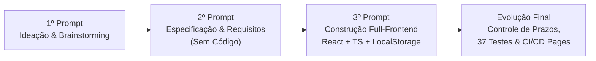
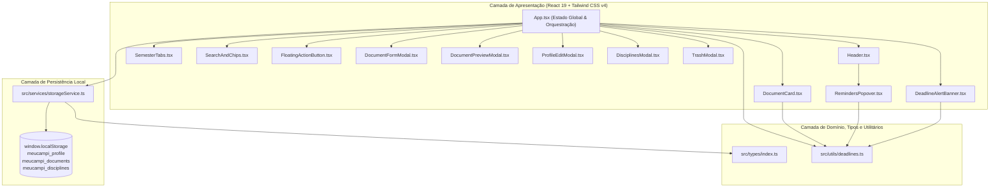

# 🎓 MeuCampi — Gestor Inteligente de Documentos Acadêmicos

> Projeto desenvolvido durante o **Desafio de Código da Imersão Alura com Google for Startups**.  
> Uma aplicação web moderna (SPA) projetada para centralizar, organizar e monitorar documentos universitários, disciplinas, prazos de entrega e validades de comprovantes.

---

## 📋 Sumário

1. [Sobre o Projeto](#-sobre-o-projeto)
2. [Jornada de Construção (Passo a Passo com Engenharia de Prompts)](#-jornada-de-construção-passo-a-passo-com-engenharia-de-prompts)
   - [Etapa 1: Ideação e Descoberta do Problema (1º Prompt)](#etapa-1-ideação-e-descoberta-do-problema-1º-prompt)
   - [Etapa 2: Engenharia de Requisitos e Escopo do MVP (2º Prompt)](#etapa-2-engenharia-de-requisitos-e-escopo-do-mvp-2º-prompt)
   - [Etapa 3: Arquitetura, UI/UX e Implementação da Aplicação (3º Prompt)](#etapa-3-arquitetura-uiux-e-implementação-da-aplicação-3º-prompt)
   - [Etapa 4: Evolução Contínua — Prazos Acadêmicos, Testes Automatizados e CI/CD](#etapa-4-evolução-contínua--prazos-acadêmicos-testes-automatizados-e-cicd)
3. [Problema Resolvido & Público-Alvo](#-problema-resolvido--público-alvo)
4. [Funcionalidades e Requisitos Implementados](#-funcionalidades-e-requisitos-implementados)
5. [Arquitetura Técnica e Estrutura de Pastas](#-arquitetura-técnica-e-estrutura-de-pastas)
6. [Modelo de Dados e Persistência](#-modelo-de-dados-e-persistência)
7. [Suíte de Testes e Critérios de Aceite](#-suíte-de-testes-e-critérios-de-aceite)
8. [Como Executar Localmente](#-como-executar-localmente)
9. [Deploy Contínuo (CI/CD)](#-deploy-contínuo-cicd)

---

## 🎯 Sobre o Projeto

O **MeuCampi (`v1.0`)** é um organizador centralizado de documentos acadêmicos. Ao longo da graduação, estudantes lidam com múltiplos portais (SIGA, Moodle, Canvas, e-mails, grupos de mensagens) e acumulam dezenas de arquivos críticos: comprovantes de matrícula, históricos escolares, slides de aulas, listas de exercícios, termos de compromisso de estágio (TCE), certificados de horas complementares e projetos de TCC/Iniciação Científica.

O **MeuCampi** substitui pastas genéricas por uma **taxonomia acadêmica nativa**, indexando cada arquivo por **Semestre Letivo**, **Âmbito Institucional**, **Disciplina**, **Professor**, **Tags**, **Código de Autenticação Digital** e **Prazos de Entrega/Expiração**.

---

## 🚀 Jornada de Construção (Passo a Passo com Engenharia de Prompts)

O desenvolvimento do **MeuCampi** seguiu uma metodologia iterativa de **Engenharia de Prompts** estruturada em etapas progressivas — partindo da concepção da ideia, passando pela especificação funcional sem código, até a construção da arquitetura em React + TypeScript e sua evolução com testes e deploy automatizado.



---

### Etapa 1: Ideação e Descoberta do Problema (1º Prompt)

Na primeira etapa, o objetivo foi explorar o domínio do problema e gerar uma concepção inicial de produto voltada à vida universitária.

#### 💬 Prompt Utilizado:
> *"Dê uma ideia de um aplicativo de organização de documentos (pdf de aulas, documentos de matriculas, historicos, etc.) que possuem relação com a minha universidade"*

#### 💡 Resultado da Etapa:
- Nasceu o conceito inicial (**UniDocs / MeuCampi**), documentado inclusive dentro do próprio código no componente conceitual `src/components/IdeaGuideModal.tsx` e prototipado inicialmente em `src/types/document.ts` e `src/data/mockDocuments.ts`.
- Identificou-se o ponto de dor central: a fragmentação de documentos entre portais acadêmicos, WhatsApp e pastas locais, causando perda de prazos de renovação de matrícula, dificuldade em comprovar horas complementares e demora para reunir documentos de estágio.
- Definiram-se os pilares de valor: **Taxonomia Acadêmica Nativa**, **Guardião de Prazos e Validades**, **Hub de Horas Complementares** e **Organização por Semestres e Disciplinas**.

---

### Etapa 2: Engenharia de Requisitos e Escopo do MVP (2º Prompt)

Com a ideia validada, o segundo passo aplicou **Role Prompting** (*"Você é um especialista em organização de documentos"*) e **Restrição Explícita** (*"Não escreva código ainda"*) para consolidar as regras de negócio, o escopo funcional da primeira versão (MVP) e os critérios de teste antes de iniciar a codificação.

#### 💬 Prompt Utilizado:
> *"Você é um especialista em organização de documentos.*
>
> *Vamos criar o MeuCampi, uma aplicação simples que ajudará estudantes a organizar diversos documentos de suas universidades.*
>
> *A primeira versão deve permitir que o usuário:*
> *1 - Informar sua realidade na universidade.*
> *2 - Gerenciar documentos.*
> *3 - Escolher âmbitos/tags existentes.*
> *4 - Mapear arquivos.*
> *5 - Busca avançada e filtro rápido.*
>
> *O que o usuário pode fazer em cada funcionalidade:*
> *1 - informar universidade e curso, definir semestre atual, selecionar período letivo vigente (ex: 2026.2).*
> *2 - cadastro (upload do arquivo ou foto, titulo para o documento, âmbito pré-definido, semestre letivo, disciplina (opcional), professor (opcional), descrição (opcional) e tags pré-definidas de acordo com os âmbitos ou customizadas (opcional)); vizualizar (vizular documento com pré vizualização e ver cartão com detalhes com metadados); editar (corrigir metadados e substituir arquivo); excluir (move documento para a lixeira por 30 dias temporarios antes de definitiva).*
> *3 - escolher âmbito pré-definido: Secretaria & Matrícula, Aulas & Atividades, Certificados & Horas, Projetos & Pesquisa, Estágio & Carreira.*
> *4 - Cadastrar Disciplinas: Nome e nome do professor; Associar a documentos na hora do gerenciamento.*
> *5 - Busca por texto livre, Filtro por semestre, âmbito ou tag.*
>
> *Organize sua resposta em:*
> *- Problema que a aplicação resolve*
> *- Publico alvo*
> *- Requisito funcionais*
> *- Criterios que podemos utilizar para testar a primeira versão*
>
> *Não escreva codigo ainda."*

#### 💡 Resultado da Etapa:
1. **Definição clara do Problema:** Eliminação do caos documental acadêmico com categorização padronizada e prevenção de perda acidental através de uma lixeira com retenção de 30 dias.
2. **Mapeamento do Público-Alvo:** Estudantes de graduação/pós-graduação, estagiários, bolsistas de iniciação científica/monitoria e representantes de turma.
3. **Especificação de Requisitos Funcionais (RF01 a RF05):**
   - **RF01 (Realidade Universitária):** Configuração de instituição, curso, semestre ordinal e período letivo ativo.
   - **RF02 (Ciclo de Vida de Documentos):** CRUD completo (Upload/Cadastro, Visualização com Preview, Edição com substituição de arquivo e Exclusão lógica para Lixeira de 30 dias).
   - **RF03 (Taxonomia de Âmbitos e Tags):** 5 âmbitos institucionais fixos com tags sugeridas + tags customizadas.
   - **RF04 (Mapeamento de Disciplinas):** Cadastro de disciplinas e docentes vinculados aos documentos.
   - **RF05 (Busca e Filtragem):** Pesquisa textual livre combinada com filtros de semestre, âmbito, disciplina e tags.
4. **Critérios de Aceite e Testes:** Base estrutural que deu origem aos cenários validados na suíte de testes (`tests/systemIntegration.test.mjs`).

---

### Etapa 3: Arquitetura, UI/UX e Implementação da Aplicação (3º Prompt)

Com o documento de requisitos fechado, o terceiro prompt direcionou a construção completa da aplicação, especificando **público**, **regras funcionais**, **padrões de interface (UI/UX)**, **requisitos técnicos de engenharia de software** e uma instrução de **autoverificação** ao final.

#### 💬 Prompt Utilizado:
> *"Crie uma aplicação web chamada MeuCampi para organizar documentos acadêmicos.*
>
> *Público:*  
> *Estudantes, Estagiários, Bolsistas, Líderes de turma e Bolsistas que precisam gerenciar seus materiais, seja de aula, de historico, didaticos, etc.*
>
> *O que o sistema deve permitir:*
> *- cadastrar realidade universitaria com nome da universidade e curso, registro de semestre e periodo letivo e edição se preciso.*
> *- gestão de documento com cadastro de informações (titulo, ambito, semestre, disciplina, professor, descricao, tags) e upload, vizualização (preview do documento e metadados), edição (metadados e substituição de arquivo), exclusão (com tempo para restauração).*
> *- escolher ambito pré definido: Secretaria & Matrícula, Aulas & Atividades, Certificados & Horas, Projetos & Pesquisa, Estágio & Carreira; além de sugestão de tags por ambito e criação de tags customizadas.*
> *- mapear arquivos: criar disciplina com nome e nome do professor, associar a documento e visualizar documentos por disciplina.*
> *- buscar por texto livre e filtrar por semestre, ambito ou tags.*
>
> *Requisitos de interface:*
> *- Dashboard por Semestres em Abas Horizontais*
> *- Botão Flutuante (FAB) de Upload Rápido*
> *- Feed de Cards com Badges Coloridos*
> *- Barra de Pesquisa Global com Chips de Filtro*
> *- Formulário Modal de Preenchimento Progressivo*
>
> *Requisitos técnicos:*
> *- usar typescript*
> *- separar a interface em componentes*
> *- separar o tipos de dados*
> *- criar um servico de armazenamento*
> *- nao utilizar backend neste primeira versão*
>
> *antes de finalizar, analise se todos os requisitos foram implementados corretamente."*

#### 💡 Resultado da Etapa:
A aplicação ganhou sua arquitetura modular definitiva em React 19 + TypeScript + Tailwind CSS:
- **Separação de Tipos (`src/types/index.ts`):** Interfaces fortemente tipadas (`UniversityProfile`, `Discipline`, `DocumentItem`, `AcademicScope`) e dicionário de configuração visual `ACADEMIC_SCOPES`.
- **Serviço de Armazenamento (`src/services/storageService.ts`):** Persistência 100% client-side em `localStorage` (sem necessidade de backend), com dados padrão realistas da UNICAMP, auto-purge de itens na lixeira há mais de 30 dias e tratamento de erros (`try/catch`) contra armazenamento indisponível ou corrompido.
- **Componentização de Interface (`src/components/`):**
  - `SemesterTabs.tsx`: Dashboard horizontal por semestres com contadores dinâmicos e indicador de período vigente.
  - `FloatingActionButton.tsx`: Botão flutuante (FAB) para upload rápido em dispositivos móveis e desktop.
  - `DocumentCard.tsx`: Feed de cards responsivos com badges coloridos por âmbito, tags clicáveis e ações rápidas.
  - `SearchAndChips.tsx`: Barra de pesquisa global com filtro por disciplina e chips interativos de âmbitos e tags.
  - `DocumentFormModal.tsx`: Modal de preenchimento progressivo em **3 etapas** (1. Arquivo & Título → 2. Âmbito & Semestre → 3. Prazos & Detalhes), incluindo criação rápida inline de disciplinas.
  - `DocumentPreviewModal.tsx`, `ProfileEditModal.tsx`, `DisciplinesModal.tsx` e `TrashModal.tsx`.

---

### Etapa 4: Evolução Contínua — Prazos Acadêmicos, Testes Automatizados e CI/CD

Após cumprir 100% dos requisitos dos 3 prompts iniciais, o projeto recebeu incrementos de qualidade de nível de produção (visíveis no histórico de commits do Git):

1. **Controle de Prazos e Lembretes Acadêmicos (`src/utils/deadlines.ts`):**
   - Adição de `dueDate` e `dueDateType` (`entrega` para trabalhos/listas/TCC e `expiracao` para atestados/certificados).
   - Criação da central de lembretes no topo (`RemindersPopover.tsx`) e do banner de alerta crítico (`DeadlineAlertBanner.tsx`).
   - Novos chips de filtro rápido: **Com Prazos** e **Prazos Urgentes**.
2. **Suíte de Testes Automatizados (`tests/`):**
   - `tests/academicDeadlines.test.mjs` e `tests/systemIntegration.test.mjs` cobrindo **37 cenários** de regras de negócio, CRUD, lixeira de 30 dias, filtros multicritério e resiliência.
3. **Pipeline CI/CD para GitHub Pages (`.github/workflows/deploy.yml`):**
   - Deploy automatizado a cada push na branch `main` utilizando GitHub Actions e Node.js 22.

---

## 👥 Problema Resolvido & Público-Alvo

| Dimensão | Detalhamento |
| :--- | :--- |
| **Problema** | Desorganização e perda de documentos acadêmicos espalhados em múltiplos sistemas (SIGAA/Moodle/Canvas, e-mail, WhatsApp), falta de controle sobre datas de entrega/validade de atestados e dificuldade de localizar comprovantes rapidamente. |
| **Estudantes de Graduação e Pós** | Centralizam matrículas, históricos, ementas, apostilas e listas de exercícios por semestre letivo. |
| **Estagiários** | Gerenciam Termos de Compromisso de Estágio (TCE), termos aditivos, seguros e relatórios periódicos com controle de vencimento. |
| **Bolsistas (IC, Monitoria, Extensão)** | Organizam certificados de congressos, relatórios de pesquisa, pré-projetos de TCC e horas complementares. |
| **Líderes / Representantes de Turma** | Mantêm calendários oficiais, comunicados da secretaria e materiais compartilhados acessíveis por disciplina e professor. |

---

## ✨ Funcionalidades e Requisitos Implementados

### 1. Realidade Universitária (`Header.tsx` & `ProfileEditModal.tsx`)
- Exibição permanente da instituição (ex: *UNICAMP*), curso (*Bacharelado em Ciência da Computação*), semestre atual (*6º Semestre*), período vigente (*2026.2*), nome do aluno e RA.
- Edição rápida via modal dedicado com persistência imediata.

### 2. Gestão Completa de Documentos (CRUD + Lixeira 30 Dias)
- **Cadastro Progressivo (`DocumentFormModal.tsx`):**
  - **Passo 1:** Upload drag-and-drop (PDF, PNG, JPG, WEBP, DOC) com conversão Base64 via `FileReader`, autopreenchimento inteligente do título a partir do nome do arquivo, cálculo automático de tamanho em MB e código de validação digital opcional.
  - **Passo 2:** Escolha visual de um dos 5 âmbitos institucionais e seleção do semestre letivo (`2026.2`, `2026.1`, ..., `Permanente`).
  - **Passo 3:** Ativação opcional de prazo (`entrega` ou `expiracao`) com atalhos rápidos (`+3 dias`, `+7 dias`, `+15 dias`, `+30 dias`), associação de disciplina (ou cadastro inline de nova disciplina), professor, descrição e seleção de tags sugeridas ou personalizadas.
- **Visualização (`DocumentPreviewModal.tsx`):**
  - Simulação visual do documento ou renderização do arquivo carregado (imagem/PDF), exibição do código de autenticação digital, status detalhado do prazo, botões de download/impressão e atalhos para edição ou exclusão.
- **Edição:**
  - Reabre o formulário progressivo preenchido com todos os metadados atuais, permitindo atualizar qualquer campo ou substituir o arquivo.
- **Exclusão Lógica e Lixeira (`TrashModal.tsx`):**
  - Documentos excluídos vão para a lixeira com marcação `isDeleted: true` e `deletedAt`.
  - Contador de dias restantes (de 30 a 0 dias) antes da exclusão automática definitiva.
  - Permite **Restaurar**, **Excluir Permanentemente** um item ou **Esvaziar Lixeira**.

### 3. Taxonomia de 5 Âmbitos Institucionais (`ACADEMIC_SCOPES`)

| ID (`AcademicScope`) | Rótulo na Interface | Cor do Badge | Tags Sugeridas Automaticamente |
| :--- | :--- | :--- | :--- |
| `secretaria` | **Secretaria & Matrícula** | Azul (`blue`) | `#Matrícula`, `#Atestado`, `#Histórico`, `#PasseEscolar`, `#Comprovante`, `#Calendário` |
| `aulas` | **Aulas & Atividades** | Violeta (`violet`) | `#Slides`, `#ListaExercicios`, `#Ementa`, `#Resumo`, `#Laboratório`, `#ProvaP1`, `#ProvaP2` |
| `certificados` | **Certificados & Horas** | Âmbar (`amber`) | `#HorasComplementares`, `#Congresso`, `#CursoExtensao`, `#Workshop`, `#Monitoria`, `#Palestra` |
| `projetos` | **Projetos & Pesquisa** | Esmeralda (`emerald`) | `#IniciacaoCientifica`, `#TCC`, `#Artigo`, `#Banner`, `#RelatorioPesquisa`, `#RelatorioFinal` |
| `estagio` | **Estágio & Carreira** | Ciano (`cyan`) | `#TCE`, `#TermoAditivo`, `#RelatorioAtividades`, `#SeguroEstagio`, `#Contrato`, `#PlanoDeEstagio` |

### 4. Mapeamento de Disciplinas (`DisciplinesModal.tsx`)
- Cadastro de disciplinas com nome da matéria, nome do docente e semestre.
- Contabilização automática de quantos documentos estão vinculados a cada disciplina.
- Botão para filtrar o feed diretamente pelos documentos de uma disciplina específica.

### 5. Busca Global, Filtros Multicritério e Controle de Prazos (`SearchAndChips.tsx` & `deadlines.ts`)
- **Abas Horizontais de Semestre (`SemesterTabs.tsx`):** Filtra por todos os semestres ou por um período específico, destacando o período ativo do perfil.
- **Busca Textual Instantânea:** Pesquisa simultaneamente em `title`, `description`, `disciplineName`, `professorName`, `verificationCode` e `tags`.
- **Classificação Inteligente de Prazos (`getDeadlineInfo`):**
  - `expired` (< 0 dias): Vermelho/Rosa (*"Venceu ontem"* / *"Venceu há X dias"*) — **Urgente**
  - `today` (0 dias): Vermelho pulsante (*"Vence hoje!"*) — **Urgente**
  - `urgent` (1 a 3 dias): Âmbar (*"Vence amanhã!"* / *"Entrega/Expira em X dias"*) — **Urgente**
  - `warning` (4 a 7 dias): Índigo (*"Entrega/Expira em X dias"*)
  - `normal` (> 7 dias): Cinza/Slate (*"Prazo: DD/MM"*)

---

## 🏗️ Arquitetura Técnica e Estrutura de Pastas



### Estrutura de Arquivos do Repositório

```text
meucampi/
├── .github/
│   └── workflows/
│       └── deploy.yml                  # Pipeline CI/CD para deploy no GitHub Pages
├── index.html                          # Template HTML principal
├── metadata.json                       # Metadados descritivos da aplicação
├── package.json                        # Scripts e dependências do projeto
├── tsconfig.json                       # Configuração do compilador TypeScript
├── vite.config.ts                      # Configuração do bundler Vite + Tailwind CSS
├── src/
│   ├── main.tsx                        # Ponto de entrada React (createRoot)
│   ├── App.tsx                         # Componente raiz, filtros, estado e modais
│   ├── index.css                       # Estilos globais e importação do Tailwind CSS
│   ├── types/
│   │   ├── index.ts                    # Tipagens principais (DocumentItem, UniversityProfile, etc.)
│   │   └── document.ts                 # Tipagens do protótipo inicial (AcademicDocument, DossierPreset)
│   ├── services/
│   │   └── storageService.ts           # Serviço CRUD client-side sobre localStorage
│   ├── utils/
│   │   └── deadlines.ts                # Cálculo de dias restantes e badges de prazos
│   ├── data/
│   │   └── mockDocuments.ts            # Dados mockados do protótipo inicial
│   └── components/
│       ├── Header.tsx                  # Barra superior com perfil, lembretes, disciplinas e lixeira
│       ├── RemindersPopover.tsx        # Central de notificações de prazos ordenada por urgência
│       ├── SemesterTabs.tsx            # Abas horizontais de navegação por semestre letivo
│       ├── DeadlineAlertBanner.tsx     # Banner de alerta para documentos vencidos ou urgentes
│       ├── SearchAndChips.tsx          # Barra de busca textual e filtros por âmbito, tag, disciplina e prazo
│       ├── DocumentCard.tsx            # Card individual de documento no feed
│       ├── FloatingActionButton.tsx    # Botão flutuante (FAB) para novo documento
│       ├── DocumentFormModal.tsx       # Modal de cadastro/edição progressivo em 3 passos
│       ├── DocumentPreviewModal.tsx    # Modal de visualização e pré-visualização de conteúdo
│       ├── ProfileEditModal.tsx        # Modal de edição da realidade universitária
│       ├── DisciplinesModal.tsx        # Modal de gerenciamento de disciplinas e professores
│       ├── TrashModal.tsx              # Modal da lixeira com retenção de 30 dias
│       └── IdeaGuideModal.tsx          # Modal de documentação conceitual da ideia inicial
└── tests/
    ├── academicDeadlines.test.mjs      # Testes unitários do motor de prazos (deadlines.ts)
    └── systemIntegration.test.mjs      # Testes integrados de CRUD, lixeira, perfil e filtros
```

---

## 💾 Modelo de Dados e Persistência

O serviço `storageService.ts` gerencia três chaves independentes no `localStorage`:

1. **`meucampi_profile` (`UniversityProfile`):**
   - `universityName`, `courseName`, `currentSemesterOrdinal`, `activePeriod`, `studentName`, `registrationNumber`.
2. **`meucampi_disciplines` (`Discipline[]`):**
   - `id`, `name`, `professorName`, `semester`.
3. **`meucampi_documents` (`DocumentItem[]`):**
   - `id`, `title`, `scope`, `semester`, `disciplineId`, `disciplineName`, `professorName`, `description`, `tags`, `fileName`, `fileType`, `fileSize`, `fileDataUrl`, `sampleContent`, `verificationCode`, `dueDate`, `dueDateType`, `createdAt`, `updatedAt`, `isDeleted`, `deletedAt`.

> **Mecanismos de Resiliência no `storageService`:**
> - **Auto-migração:** Documentos padrão de versões anteriores sem `dueDate` recebem automaticamente as datas de exemplo ao inicializar.
> - **Auto-purge de 30 dias:** Toda chamada a `getDocuments()` remove automaticamente do armazenamento qualquer item cuja data `deletedAt` ultrapasse 30 dias.
> - **Fallback Seguro:** Caso o `localStorage` esteja bloqueado ou contenha JSON inválido, o serviço captura a exceção e retorna os dados padrão sem interromper a renderização.

---

## 🧪 Suíte de Testes e Critérios de Aceite

O projeto conta com testes automatizados executados via `node --test`:

- **`tests/academicDeadlines.test.mjs`:** Valida cálculos de dias restantes, classificação em `expired`, `today`, `urgent`, `warning` e `normal`, diferenciação semântica entre `entrega` e `expiracao`, ordenação por prioridade na central de lembretes e montagem do payload do formulário.
- **`tests/systemIntegration.test.mjs`:** Valida a inicialização do `storageService`, criação, edição, remoção de prazos, ciclo completo da lixeira (mover, restaurar, excluir permanentemente, esvaziar e expiração após 31 dias), CRUD de perfil e disciplinas, busca textual global, combinação multicritério de 5 filtros simultâneos e recuperação contra dados corrompidos no `localStorage`.

---

## 💻 Como Executar Localmente

### Pré-requisitos
- **Node.js** (v20 ou v22 recomendado)
- **npm**

### Passo a Passo

```bash
# 1. Clonar o repositório
git clone https://github.com/kenzofrias/meucampi.git
cd meucampi

# 2. Instalar as dependências
npm install --legacy-peer-deps

# 3. Iniciar o servidor de desenvolvimento (porta 3000)
npm run dev

# 4. Verificar tipagem TypeScript
npm run lint

# 5. Executar a suíte de testes automatizados
node --test tests/*.test.mjs

# 6. Gerar build de produção
npm run build
```

---

## 🌐 Deploy Contínuo (CI/CD)

O arquivo `.github/workflows/deploy.yml` configura a publicação automática no **GitHub Pages**:
- Dispara automaticamente em cada `push` na branch `main` (ou manualmente via `workflow_dispatch`).
- Configura o ambiente com **Node.js 22**, instala dependências com `npm install --legacy-peer-deps`, compila os ativos estáticos com `npm run build` (com `base: './'` configurado no `vite.config.ts`) e publica o diretório `./dist` no GitHub Pages.

---

<div align="center">
  
  **Obrigado pela visita!**  
  [Kenzo Friás](https://www.github.com/kenzofrias) © 2026
  
</div>
